<p align="center">
  
</p>

> Surveillance des navires via l'API EuRIS par tâche planifiée, et notifications push vers l'application mobile.

   

**Statut** — 🟢 Déployé sur Railway

---

# TrackShip Backend

[](https://railway.app/template/new)
[](https://opensource.org/licenses/MIT)
[](https://nodejs.org)

Backend server Node.js Express pour l'application mobile TrackShip. Gère les notifications push Expo et la surveillance des navires via l'API EuRIS.

## Vue d'ensemble

Ce serveur permet de :
- Enregistrer les tokens Expo des utilisateurs mobiles
- Surveiller les navires dans une zone de 3km via l'API EuRIS
- Envoyer automatiquement des notifications push quand un nouveau navire est détecté
- Fournir une API REST pour l'app mobile

## Structure du projet

```
trackship-backend/
├── server.js                   # Point d'entrée, serveur Express
├── services/
│   ├── notificationService.js  # Gestion des notifications Expo
│   └── eurisApi.js            # Communication avec l'API EuRIS
├── workers/
│   └── shipChecker.js         # Cron job de surveillance des navires
├── utils/
│   ├── distanceCalculator.js  # Calcul de distances (Haversine)
│   └── logger.js              # Système de logs
├── config/
│   └── constants.js           # Constantes et configuration
├── package.json
├── railway.json              # Configuration Railway.app
├── .env.example              # Template de configuration
├── .gitignore
└── RAILWAY.md                # Guide déploiement Railway
```

## Installation

### Prérequis

- Node.js >= 18.0.0
- npm ou yarn

### Étapes

1. Cloner le repository :
```bash
git clone <repository-url>
cd trackship-backend
```

2. Installer les dépendances :
```bash
npm install
```

3. Créer le fichier `.env` :
```bash
cp .env.example .env
```

4. Configurer les variables d'environnement dans `.env` :
```env
PORT=3000
NODE_ENV=development
BASE_LAT=48.853229
BASE_LON=2.225328
EURIS_API_URL=https://www.eurisportal.eu/visuris/api/TracksV2/GetTracksByBBoxV2
EURIS_JWT_TOKEN=your_jwt_token_here
CHECK_INTERVAL=30000
LOG_LEVEL=debug
```

**Note :** Le token JWT EuRIS peut être obtenu gratuitement sur [eurisportal.eu](https://www.eurisportal.eu)

## Utilisation

### Développement

Lancer le serveur en mode développement avec nodemon (rechargement automatique) :

```bash
npm run dev
```

Le serveur démarrera sur `http://localhost:3000`

## Déploiement

### Railway.app (recommandé)

**Railway.app** est la méthode la plus simple et rapide pour déployer ce backend en production. C'est **gratuit** (500h/mois), avec SSL automatique et domaine personnalisé supporté.

**Avantages :**
- ✅ Déploiement en 2 minutes
- ✅ SSL automatique (HTTPS)
- ✅ Déploiement automatique à chaque push Git
- ✅ Logs en temps réel
- ✅ Pas de configuration serveur

**Documentation complète :** Voir [RAILWAY.md](RAILWAY.md)

**Démarrage rapide :**
1. Cliquer sur le badge "Deploy on Railway" en haut du README
2. Se connecter avec GitHub
3. Configurer les variables d'environnement suivantes :
   - `BASE_LAT=48.853229`
   - `BASE_LON=2.225328`
   - `EURIS_API_URL=https://www.eurisportal.eu/visuris/api/TracksV2/GetTracksByBBoxV2`
   - `EURIS_JWT_TOKEN=<votre_token_jwt_euris>`
   - `NODE_ENV=production`
   - `LOG_LEVEL=info`
4. Cliquer sur "Deploy"
5. Déployé en 2 minutes ! 🚀

**Variables d'environnement obligatoires pour Railway :**
```env
BASE_LAT=48.853229
BASE_LON=2.225328
EURIS_API_URL=https://www.eurisportal.eu/visuris/api/TracksV2/GetTracksByBBoxV2
EURIS_JWT_TOKEN=<votre_token_jwt_euris>
NODE_ENV=production
LOG_LEVEL=info
```

**Note :** Railway configure automatiquement le `PORT`, pas besoin de le définir.

### Alternative : Serveur VPS (Oracle Cloud, etc.)

Pour un déploiement sur votre propre serveur Ubuntu avec PM2 et Nginx.

#### Option 1 : Node.js direct

```bash
npm start
```

#### Option 2 : PM2

PM2 assure le redémarrage automatique, la gestion des logs et le monitoring.

1. Installer PM2 globalement :
```bash
npm install -g pm2
```

2. Démarrer l'application :
```bash
npm run pm2:start
# ou directement
pm2 start ecosystem.config.js
```

3. Commandes PM2 utiles :
```bash
pm2 status                    # Voir le status
pm2 logs trackship-backend    # Voir les logs en temps réel
pm2 restart trackship-backend # Redémarrer
pm2 stop trackship-backend    # Arrêter
pm2 delete trackship-backend  # Supprimer
pm2 monit                     # Monitoring temps réel
```

4. Configuration du démarrage automatique au boot :
```bash
pm2 startup
pm2 save
```

## API Endpoints

### Health Check
```
GET /health
```
Retourne l'état du serveur et les statistiques.

**Réponse :**
```json
{
  "status": "ok",
  "timestamp": "2024-01-01T12:00:00.000Z",
  "uptime": 3600,
  "registeredTokens": 5
}
```

### Enregistrer un token
```
POST /register-token
Content-Type: application/json

{
  "token": "ExpoToken[xxxxxxxxxxxxxxxxxxxxxx]"
}
```
Enregistre un token Expo pour recevoir les notifications.

### Désinscrire un token
```
POST /unregister-token
Content-Type: application/json

{
  "token": "ExpoToken[xxxxxxxxxxxxxxxxxxxxxx]"
}
```

### Lister les navires (debug)
```
GET /ships?lat=48.853229&lon=2.225328&radius=5000
```
Retourne les navires dans un rayon donné.

### Compter les tokens (debug)
```
GET /tokens/count
```
Retourne le nombre de tokens enregistrés.

## Configuration

### Variables d'environnement

| Variable | Description | Défaut |
|----------|-------------|--------|
| `PORT` | Port du serveur | `3000` |
| `NODE_ENV` | Environnement (development/production) | `development` |
| `BASE_LAT` | Latitude de la base | `48.853229` |
| `BASE_LON` | Longitude de la base | `2.225328` |
| `EURIS_API_URL` | URL de l'API EuRIS (appel direct) | `https://www.eurisportal.eu/visuris/api/TracksV2/GetTracksByBBoxV2` |
| `EURIS_JWT_TOKEN` | Token JWT pour l'API EuRIS | *requis* |
| `CHECK_INTERVAL` | Intervalle de vérification (ms) | `30000` |
| `LOG_LEVEL` | Niveau de log (debug/info/warn/error) | `debug` |
| `CORS_ORIGINS` | Origines CORS autorisées | `*` |

### Zones de détection

Les zones sont définies dans [config/constants.js](config/constants.js) :

- **Zone 1** : 1km (non utilisée actuellement)
- **Zone 2** : 2km (non utilisée actuellement)
- **Zone 3** : 3km (zone de notification)

## Déploiement VPS détaillé (Oracle Cloud, DigitalOcean, etc.)

### 1. Préparer le serveur Ubuntu

```bash
# Se connecter en SSH
ssh ubuntu@<ip-du-serveur>

# Installer Node.js et npm
curl -fsSL https://deb.nodesource.com/setup_18.x | sudo -E bash -
sudo apt install -y nodejs

# Installer PM2
sudo npm install -g pm2

# Créer le dossier de l'application
mkdir -p /var/www/trackship-backend
```

### 2. Déployer l'application

```bash
# Depuis votre machine locale, copier les fichiers
scp -r * ubuntu@<ip-du-serveur>:/var/www/trackship-backend/

# Ou utiliser Git
cd /var/www/trackship-backend
git clone <repository-url> .
```

### 3. Configurer

```bash
cd /var/www/trackship-backend
npm install --production
cp .env.example .env
nano .env  # Éditer la configuration
```

### 4. Lancer avec PM2

```bash
pm2 start ecosystem.config.js
pm2 startup
pm2 save
```

### 5. Configurer le domaine (api.bakabi.fr)

Installer et configurer Nginx comme reverse proxy :

```bash
sudo apt install -y nginx

sudo nano /etc/nginx/sites-available/trackship-backend
```

Configuration Nginx :
```nginx
server {
    listen 80;
    server_name api.bakabi.fr;

    location / {
        proxy_pass http://localhost:3000;
        proxy_http_version 1.1;
        proxy_set_header Upgrade $http_upgrade;
        proxy_set_header Connection 'upgrade';
        proxy_set_header Host $host;
        proxy_cache_bypass $http_upgrade;
    }
}
```

Activer la configuration :
```bash
sudo ln -s /etc/nginx/sites-available/trackship-backend /etc/nginx/sites-enabled/
sudo nginx -t
sudo systemctl restart nginx
```

### 6. Configurer SSL avec Let's Encrypt

```bash
sudo apt install -y certbot python3-certbot-nginx
sudo certbot --nginx -d api.bakabi.fr
```

## Logs

Les logs sont gérés par le logger personnalisé et capturés par PM2.

### Voir les logs en développement
Les logs s'affichent directement dans la console.

### Voir les logs en production (PM2)
```bash
pm2 logs trackship-backend
pm2 logs trackship-backend --lines 100
```

Les fichiers de logs PM2 sont stockés dans :
- `./logs/error.log` - Erreurs
- `./logs/out.log` - Sortie standard

## Fonctionnement

### Détection des navires

1. Le worker `shipChecker` s'exécute toutes les 30 secondes (configurable)
2. Il appelle l'API EuRIS pour récupérer les navires dans un rayon de 3km
3. Il compare avec l'état précédent (stocké en mémoire)
4. Si un **nouveau** navire est détecté, une notification est envoyée à tous les tokens enregistrés
5. Les navires qui quittent la zone sont retirés de la mémoire après 5 minutes

### Notifications

Les notifications sont envoyées via l'Expo Server SDK avec :
- Titre : "🚢 Nouveau navire détecté !"
- Corps : Nom du navire et distance
- Data : Informations complètes du navire (MMSI, coordonnées, cap, vitesse, etc.)

## Troubleshooting

### Le serveur ne démarre pas

Vérifier les logs :
```bash
pm2 logs trackship-backend
```

Vérifier la configuration :
```bash
cat .env
```

### Pas de notifications

1. Vérifier que des tokens sont enregistrés :
```bash
curl http://localhost:3000/tokens/count
```

2. Vérifier les logs du worker :
```bash
pm2 logs trackship-backend | grep "ship check"
```

3. Tester manuellement l'API EuRIS :
```bash
curl "http://localhost:3000/ships?lat=48.853229&lon=2.225328&radius=5000"
```

### Erreurs de mémoire

Si vous utilisez PM2, augmenter la limite dans `ecosystem.config.js` :
```javascript
max_memory_restart: '1G'
```

## Développement

### Architecture

- **server.js** : Serveur Express, routes API
- **services/** : Logique métier réutilisable
- **workers/** : Tâches planifiées (cron jobs)
- **utils/** : Fonctions utilitaires
- **config/** : Configuration et constantes

### Ajouter une nouvelle route

Éditer [server.js](server.js) :
```javascript
app.get('/nouvelle-route', (req, res) => {
  res.json({ message: 'Hello' });
});
```

### Modifier l'intervalle de vérification

Éditer `.env` :
```env
CHECK_INTERVAL=60000  # 60 secondes
```

## Technologies utilisées

- **Node.js** - Runtime JavaScript
- **Express** - Framework web
- **expo-server-sdk** - Notifications push Expo
- **node-cron** - Planification de tâches
- **axios** - Client HTTP
- **dotenv** - Gestion des variables d'environnement
- **cors** - Gestion CORS
- **PM2** - Process manager

## Licence

MIT - Voir le fichier [LICENSE](LICENSE) pour plus de détails.

## Contribution

Les contributions sont les bienvenues ! N'hésitez pas à ouvrir une issue ou une pull request.

## Support

Pour toute question ou problème :
- Consulter la [documentation Railway](RAILWAY.md)
- Ouvrir une issue GitHub
- Consulter les logs de l'application
